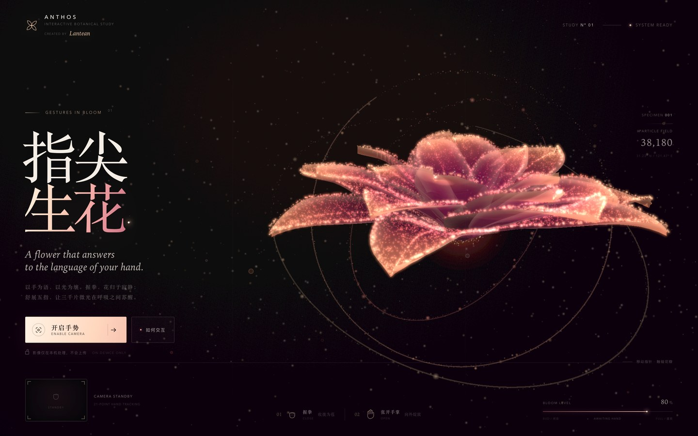
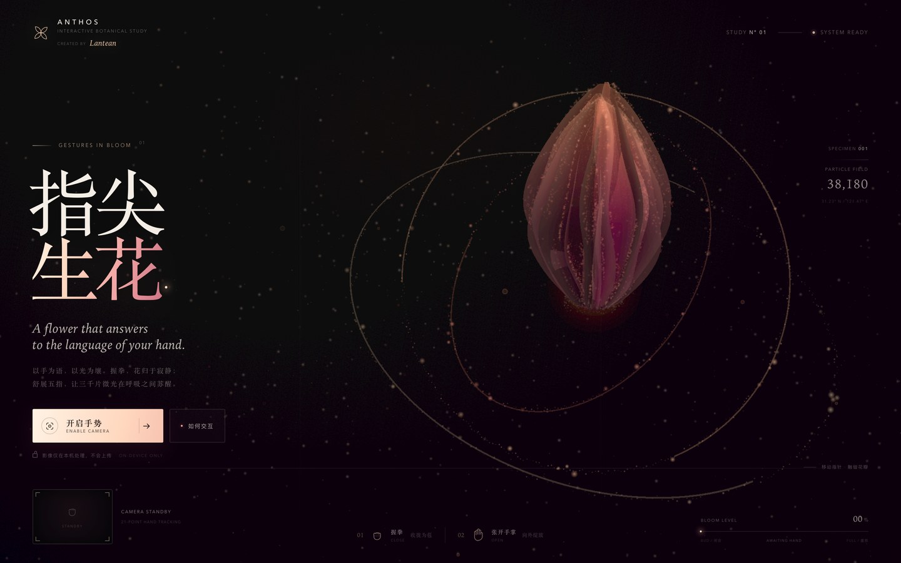
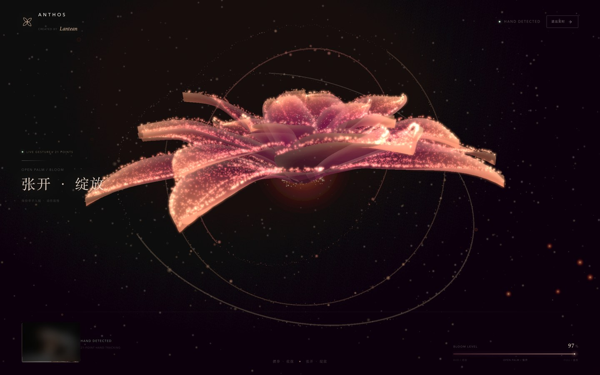

# ANTHOS · 指尖生花

> Concept, design & code by **Lantean**.

一支用手势唤醒的粒子花。  
握拳，花收拢成苞；张开手掌，三千片微光向外醒来。移动指尖，还会把花瓣上的光轻轻推开。

| 手掌张开 · 绽放 | 握拳 · 收拢为苞 |
| :---: | :---: |
|  |  |

开启手势后，页面会进入沉浸式手势模式：标题、说明和装饰信息自动退场，花朵移到画面中心，只留下实时手势读数、摄像头预览与开合程度。



## 快速开始

本项目不需要安装依赖，Three.js、MediaPipe WASM 与手部模型都已经放在 `vendor/` 中，可以完全离线运行。

```bash
cd fingertip-bloom
./start.sh
```

脚本会启动一个本地 HTTP 服务并打开 <http://127.0.0.1:4173/>。也可以手动启动：

```bash
python3 -m http.server 4173 --bind 127.0.0.1
```

然后访问：

```text
http://127.0.0.1:4173/
```

> 必须通过 HTTP 打开，不能直接双击 `index.html`。浏览器只在 `localhost` / `127.0.0.1` 或 HTTPS 页面中允许摄像头访问。

### 更换端口

```bash
./start.sh 8080
```

或：

```bash
python3 -m http.server 8080 --bind 127.0.0.1
```

## 使用方式

1. 点击 **开启手势 / ENABLE CAMERA**，允许浏览器访问摄像头。
2. 将一只手放进画面中央，保持约 40–100 cm 的距离。
3. **握拳**：花瓣向中心收拢，变成发光花苞。
4. **张开手掌**：花瓣逐层展开，粒子向外绽放。
5. **平移手掌 / 移动指尖**：整朵花会轻微跟随，指尖靠近花瓣时会产生排斥与光晕。
6. 进入手势模式后，点击右上角 **退出实时**，或按 `Esc`，可回到浏览界面。

摄像头画面只在浏览器本机通过 MediaPipe 处理，不会上传到任何服务器。

### 没有摄像头？

- 移动鼠标：指针会化作一束光，靠近时推开粒子。
- 点击画面：在闭合与盛放之间切换。
- 键盘 `Space`：切换开合。
- 键盘 `C`：开启 / 关闭摄像头。

## 技术实现

- **Three.js 0.170**：全屏 WebGL 场景、自定义 ShaderMaterial 粒子与 GLSL 动画、程序化花瓣网格、自定义双层模糊 Bloom 后期。
- **立体空间**：透视相机、程序化花瓣法线光照、花瓣之间的真实遮挡与前后明暗、倾斜的 3D 粒子轨道、景深散景与视差漂移，不再是平面式的光点扇形。
- **沉浸手势模式**：开启摄像头时切换 `body.is-camera-mode`，标题与装饰退场，花朵平滑移到画面中心并放大；同时出现极简手势读数、退出按钮与摄像头预览。摄像头出错或被拒绝时会自动回到浏览模式。
- **MediaPipe Tasks Vision / HandLandmarker**：本地 WASM + float16 手部模型，输出 21 个手部关键点。
- **原生 HTML / CSS / ES Modules**：没有构建步骤，没有前端框架，没有远程运行时依赖。
- **手势算法**：根据指尖、PIP、MCP 与手腕之间的比例和关节夹角，计算 0–1 的连续手掌开合度；针对握拳和单指/双指弯曲做了上限约束，避免误判导致花朵突然全开。
- **粒子花**：约 38,000 个粒子分为外、中、内三层花瓣，另含金色花蕊、花粉与空间浮尘。每个粒子在闭合位置与盛放位置之间按花瓣层延迟插值，因此会形成由内向外的绽放节奏。每片花瓣都有独立的抬起角度、长度和卷曲度，叠加深度写入的半透明花瓣膜，形成真实的层叠关系。
- **指尖交互**：五个指尖的位置实时传到 GLSL uniform，粒子在指尖附近产生径向排斥、旋涡偏移与亮度提升；摄像机预览中同步绘制 21 点骨架。
- **会呼吸的花**：无摄像头时进入自主呼吸演示；摄像头开启但未检测到手时，花朵保持缓慢呼吸，等待下一次手势。

## 目录结构

```text
fingertip-bloom/
├── index.html                 页面与 UI
├── css/style.css              视觉、排版、动效、响应式布局
├── js/
│   ├── main.js                场景、Bloom、手势状态、交互与启动流程
│   ├── flower.js              粒子花瓣 / 花蕊 / 浮尘 / Shader
│   ├── scenery.js             3D 轨道、粒子环、景深散景与背景纵深
│   └── handtracker.js         MediaPipe 封装、关键点平滑、手势计算、预览绘制
├── vendor/
│   ├── three.module.js        Three.js
│   ├── models/hand_landmarker.task
│   └── tasks-vision/          MediaPipe Tasks Vision 运行时与 WASM
├── start.sh
└── README.md
```

## 兼容性与排错

- 推荐使用最新版 Chrome、Edge、Safari 或 Firefox，并确保 WebGL 2 可用。
- 如果页面一直停在加载动画：打开开发者工具，确认 `js/main.js` 无报错，并确保是从项目根目录启动的 HTTP 服务。
- 如果摄像头按钮一直停在“正在开启”：在浏览器地址栏的站点设置中允许摄像头，然后刷新页面。
- 如果提示“手部识别模型加载失败”：检查 `vendor/models/hand_landmarker.task` 与 `vendor/tasks-vision/` 是否完整存在。
- 本地服务默认绑定 `127.0.0.1`，不会把摄像头页面暴露到局域网。
- 首次启动摄像头时需要加载约 26 MB 的本地模型与 WASM，加载完成后再次开启会更快。

## 许可与致谢

- [Three.js](https://threejs.org/) — MIT License
- [MediaPipe](https://developers.google.com/mediapipe) — Apache License 2.0
- 字体使用系统字体：Songti SC / Iowan Old Style / Baskerville / Avenir Next / PingFang SC。
- 花朵、粒子分布、手势算法与界面均为本项目原创实现。
